<p align="center">
  
</p>

<h1 align="center">xrnhub</h1>

The home server, watched: what it's doing right now, how much it holds, who's calling it and what
went wrong. Beside that, the one page to open each day over every xrn app: tick your habits, see
what's next, how much screen time is left and how the budget stands, then see where the year went.

The server **reads the other apps' data and never writes to it**, so removing the hub changes
nothing. The page ticks habits through xrnloops' own API under the shared sign-in, so a tick lands
exactly as if the xrnloops app had made it, and xrnrule counts it toward unlocks. The one thing it
can do to another service is restart it, when you press the button. What it keeps of its own is
the health xrnfit sends it, the events other apps report, its nudge rules, its API tokens and the
monitor's history.

It comes three ways: the web pages the server hands out, a phone app (`android/`, 0.3.2) and a
laptop window (`desktop/`, 0.1.2). All three read the same API.

The public repo is a copy, published from a private working repo by `scripts/publish-public.sh`:
each snapshot is one commit, with no history, checked first for private addresses, keys and names.

<picture>
  <source media="(prefers-color-scheme: dark)" srcset="docs/screenshots/server-dark.png">
  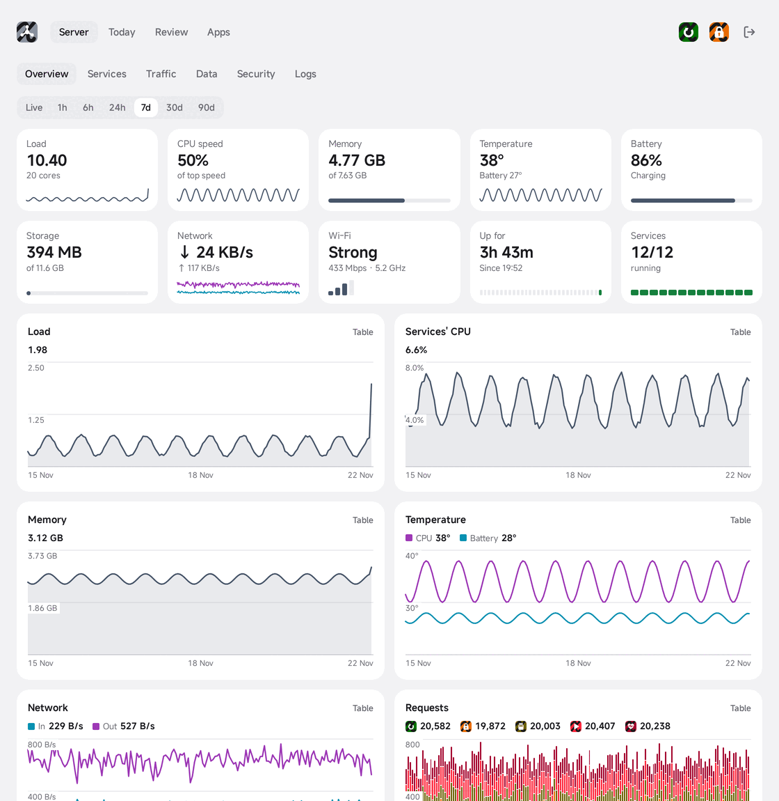
</picture>

The Server page's Overview, over the last 7 days.

<p>
  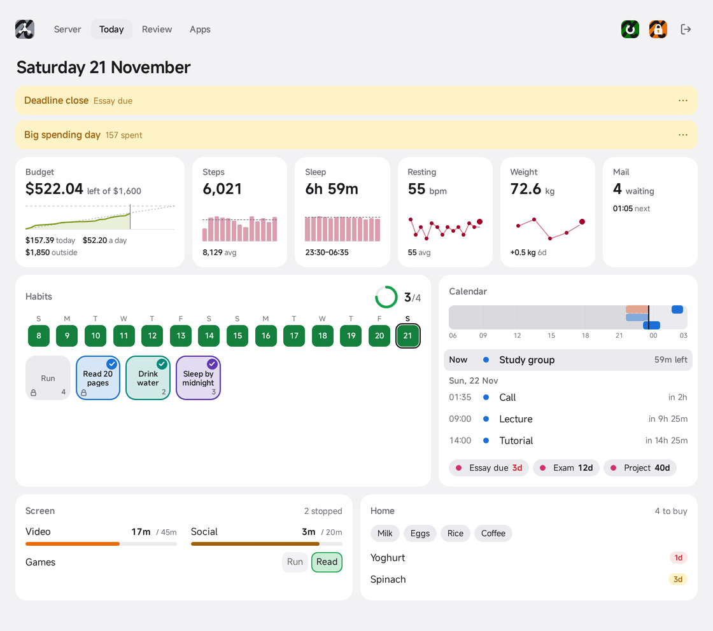
  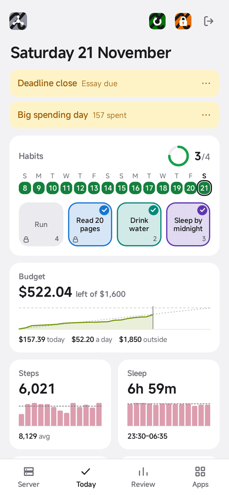
</p>

Today on a laptop and at phone width.

Everything in these screenshots is made up, served by `tests/demo_server.py`.

## Pages

### Server

The page it opens on. Only the first account in the users file can see it; anyone else gets 403
here and keeps the other pages.

- **Overview:** a chip for each thing that's wrong right now (nothing at all when all is well),
  then ten tiles: load, CPU speed, memory, temperature, battery, storage, network, Wi-Fi, uptime
  and services, each a figure with a small picture of it. Below them, charts of load, the
  services' CPU, memory, CPU and battery temperature, network and requests by service, live or over
  1 hour to 90 days, and every service with a dot and how long it's been up.
- **Services:** each one's state, uptime, CPU, memory, requests an hour and 30 days of uptime, then
  a timeline of everything that happened: downs, restarts, problems, reboots and gaps in the data.
  Open one for its figures since it started, charts of CPU, memory, requests and warnings, its 30
  days, its warnings and errors grouped by what they say, and a Restart button. The hub, ssh and
  Tailscale have no such button: restarting those could cut you off.
- **xrnfit** is listed right after the hub, which keeps what it sends. It has no process here, so
  its row says when it last sent and its strip how many readings came in each day; its page has
  the readings this week, its requests split into sent and read, its 30 days and its lines in the
  hub's log. The Overview's service list has it in the same place.
- **Traffic:** requests, changes saved, refused and failed; requests by service over time (apps
  checking in on a timer are hidden unless you ask); answers by status; each service's share; the
  busiest paths; who's calling; and the last 15 minutes of requests as they arrive.
- **Data:** how much each app holds and how many records, what came in and what was saved each
  day, bytes through the network, each app's size over time, how long the disk will last at the
  current rate, and when the last backup ran.
- **Security:** failed sign-ins, refused requests, lockouts and sign-ins; 30 days of sign-ins by
  service and address; refused paths and callers; your Tailscale devices; and what's open to the
  internet through Funnel.
- **Logs:** every service's log in one place: lines by level, warnings by service, warnings and
  errors grouped by what they say, and the newest lines, by service, level or words. Requests
  answered 2xx or 3xx stay out unless you ask: Traffic counts those.

<p>
  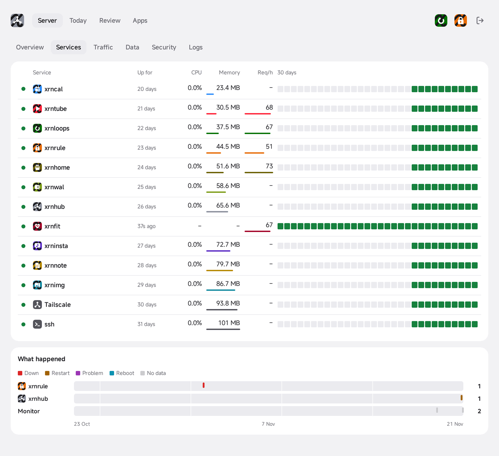
  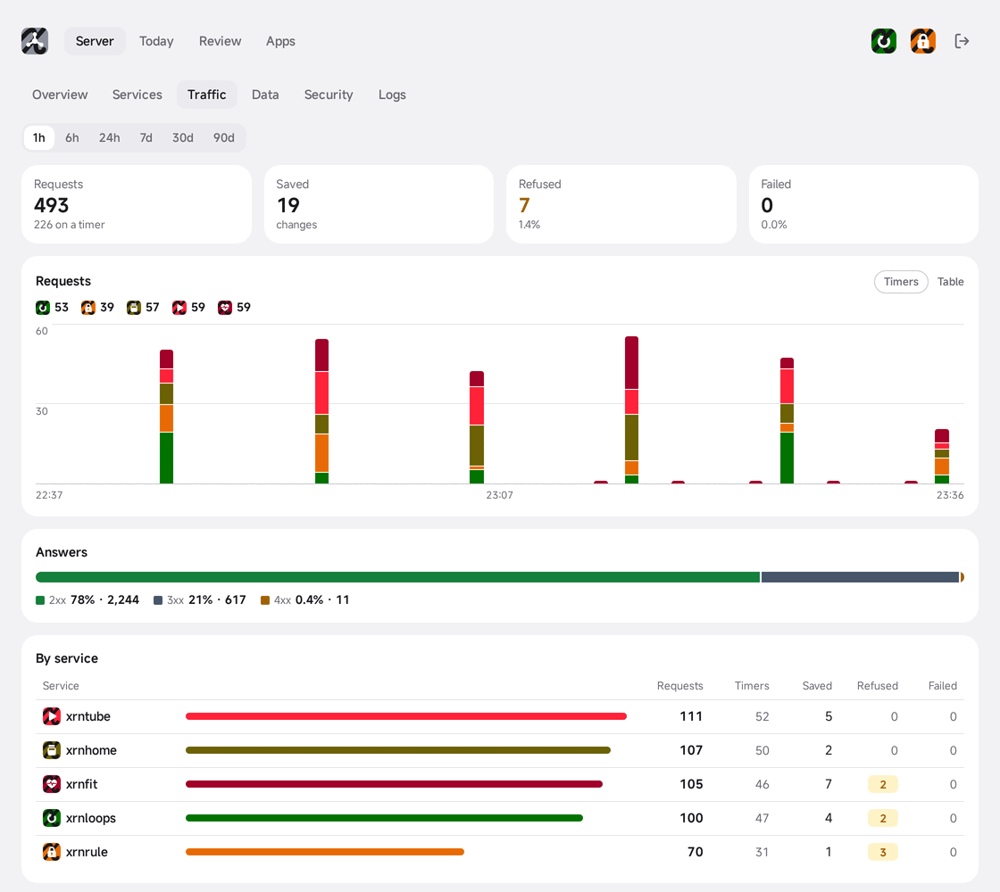
</p>
<p>
  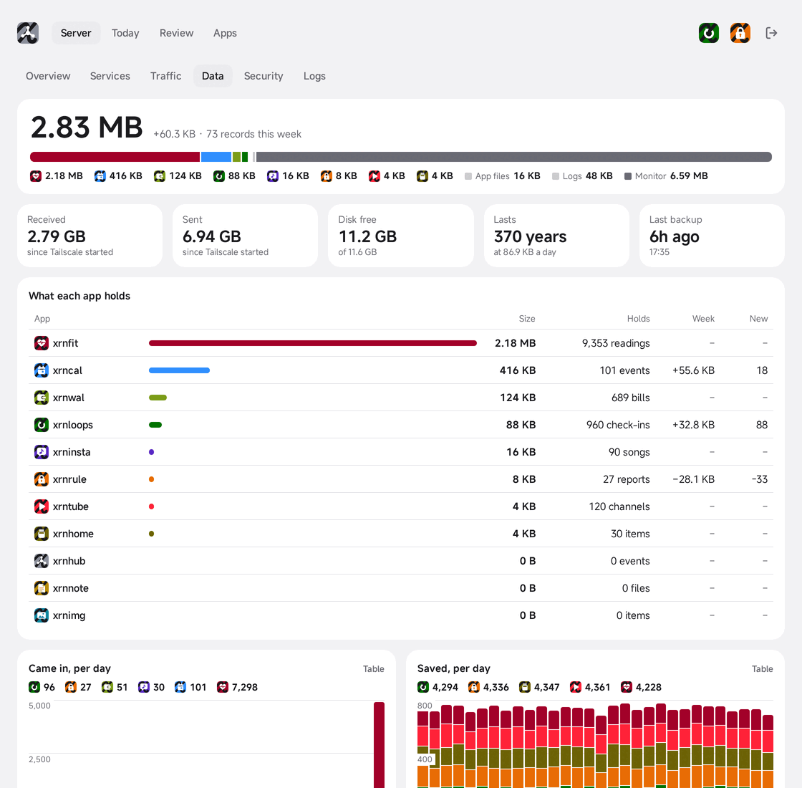
  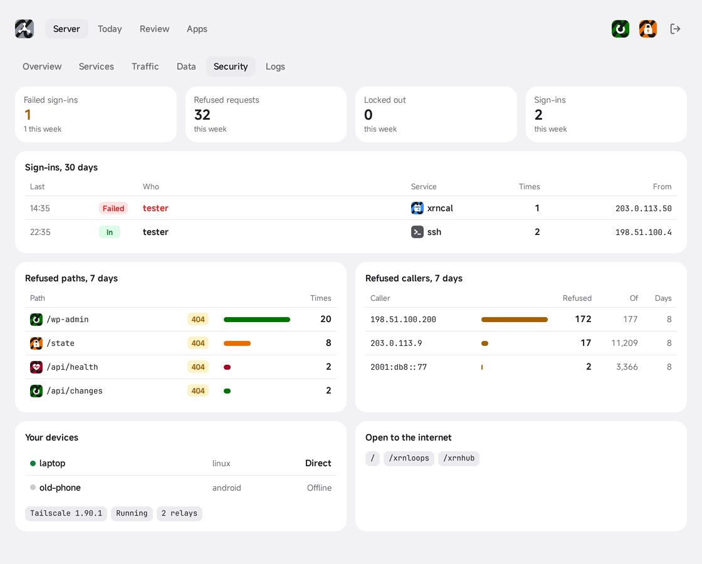
</p>

Services, Traffic, Data and Security.

The monitor tells you when the phone is unplugged, low, hot or nearly full, when a service is down
or stops answering, when runit itself is in trouble (no supervisor, or an old copy of a service
holding its port), and when the backup is old: the same limits as the laptop's daily check.
Android hides the phone's overall CPU figure and network counters from apps, so the page shows load
average, CPU speed and each service's own CPU, and counts bytes at Tailscale.

### Today

- **Nudges** at the top, when something needs saying, such as "Deadline close" or "Big spending
  day": a card that goes by itself when its condition stops holding. Its ⋯ menu hides it for the
  rest of the day, or turns its rule off. While any rule is off, the rules sit folded at the foot of
  the page, each with its switch. Six rules come built in (a deadline or exam coming up, habits
  still open in the evening, lots of blocked opens, a big spending day, the shopping list piling
  up); `PUT /api/rules` takes a new list.
- **Tiles:** the budget left this month with a burn-up chart, what was spent today, what's left a
  day and what was spent outside the budget (xrnwal's own per-bill setting, over its accounting
  month); the day's steps, last night's sleep, resting heart rate and weight, each over the last two
  weeks (xrnfit); and how many emails xrnmail is holding and when the next batch goes.
- **Habits:** a tap grid (hold one to skip it, `1`-`9` on a keyboard), with the last two weeks above
  it so a missed day is one tap away. A habit that a locked block is waiting for shows a padlock.
- **Calendar:** the day as a ribbon, what's on now and next with how long until it, all-day events,
  and countdowns to what's in calendars named for deadlines, exams, birthdays or payments.
- **Screen:** minutes left on each xrnrule limit, how many opens were stopped today, and which habits
  each locked block is waiting for.
- **Home:** the shopping list and what's about to expire, from xrnhome.

A card with nothing to say isn't drawn. The page asks again every minute and whenever it comes back
into view, and only the parts whose data changed are redrawn.

### Review

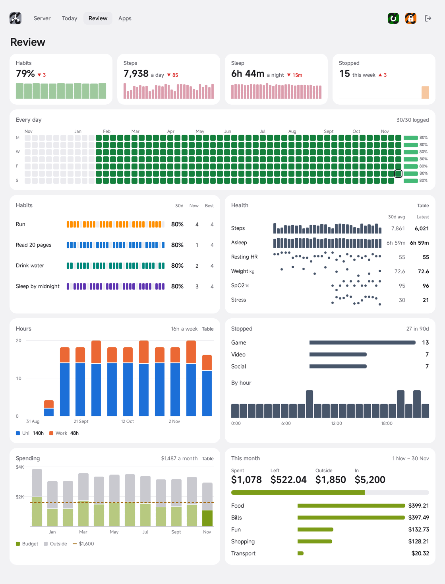

- **The week in tiles:** habits done, steps a day, sleep a night and opens stopped, each against the
  week before.
- **Every day** of the year, with each weekday's average at the end of its row.
- **Habits:** each one's last 30 days, its share, its streak now and its best, weakest first.
- **Health:** steps, sleep, resting heart rate, weight, SpO2 and stress over the same 30 days, with
  the month's average and the latest. Steps and sleep are bars from zero; the others are dots
  between the month's lowest and highest, each on its own scale.
- **Hours** a week in each calendar, in the calendar's own colours.
- **Stopped:** what xrnrule stopped over 90 days, by block and by hour of the day.
- **Spending:** each month against the budget, with what was outside it, and **this month**: spent,
  left, outside and money in, by category.

Tap any day to see it in full: fix its habits, see what was on, what xrnrule and the other apps
logged, and the day's health with the sleep's stages. Charts have a Table view, so nothing
depends on hovering or colour.

### Apps

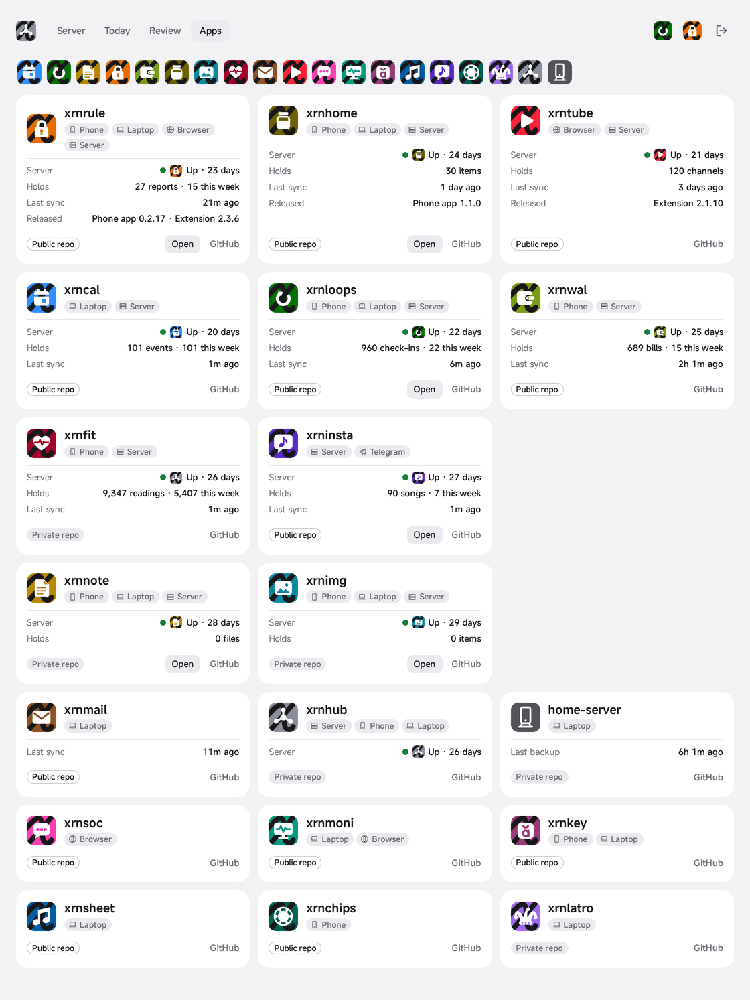

All nineteen projects, each with where it runs (phone, laptop, browser, server, Telegram), whether
its repo is public, and what the hub can see of it: which server it talks to (xrnfit's is the hub)
and whether that's up, what it holds and how much came in this week, when it last synced, and the
versions the server hands out. The tiles along the top jump to each card. Cards with as many facts
share a row. The phone app adds the version on that phone, and says when the server has a newer
one. The list is written by hand, in `server/hublib/apps.py`: a new project needs a line there.

### Keys

On a keyboard: `s` or `h` for Server, `t` for Today, `r` for Review, `a` for Apps. On Today, `1`-`9`
tick a habit, `←` `→` change day and `t` comes back to today. On a chart, `←` `→` step through it.

## Personal API

Under the pages sits a read-only JSON API over the same data: habits and their entries, the
calendar with its repeats worked out, money (balances, transactions, budgets), the home inventory,
the song-of-the-day list, xrnrule's blocks and logs, what apps report to the hub, and health
(steps, heart rate, sleep, weight, SpO2 and stress, which xrnfit sends to `POST /api/health` and the
hub keeps). It's for scripts, and later an assistant. Sign in with a read-only token made on the
server, which can read `/api/v1` and nothing else:

```sh
python xrnhub.py token add "laptop scripts" --data ~/xrnhub/data --users ~/.config/xrn-sync/users
curl -H "Authorization: Bearer xrnhub_…" https://<server>/xrnhub/api/v1/money/transactions?from=2026-11-01
```

[docs/api.md](docs/api.md) has every endpoint and field, and how xrnfit sends health. xrntube's
blocklist and mail are left out.

## Phone app

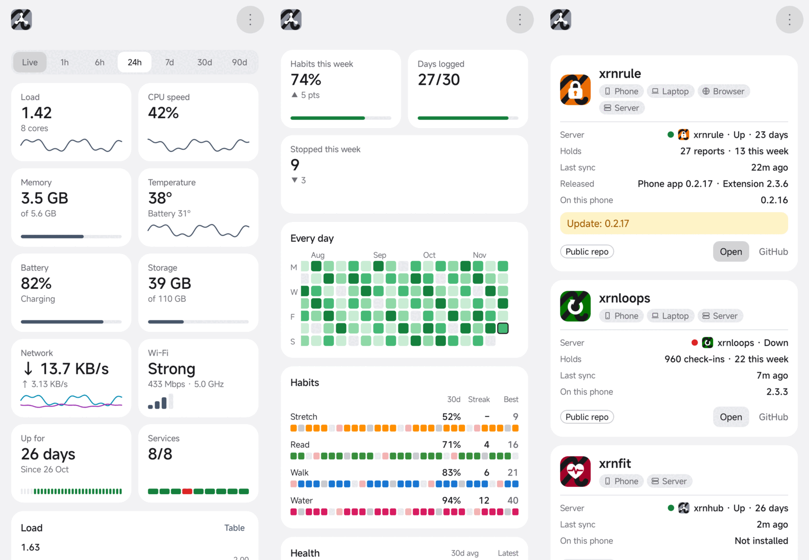

The phone app's Overview, Review and Apps, rendered from its Compose previews with made-up data
(the page tabs and the bottom bar aren't part of the previews).

`android/` is a native Android app, in Kotlin and Compose (0.3.2, build 14; Android 8 and up), with
the Server pages (Overview, Services, Traffic, Data, Security, Logs), Review and Apps. Today stays
on the web page, and so does fixing a habit: the day sheet shows them, but the app can't tick. It
reads the same API as the page, so a change to a reading on the server reaches both. Its charts are
drawn natively; a press or a drag moves a crosshair, with the numbers in a line above the plot.

```sh
cd android
./gradlew :app:testDebugUnitTest      # unit tests
ANDROID_USER_HOME=$HOME/.android ./gradlew :app:assembleRelease   # app/build/outputs/apk/release/app-release.apk
adb install -r app/build/outputs/apk/release/app-release.apk
```

Release builds are signed with the debug key in `~/.android`. Newer Android Gradle Plugins look in
`~/.config/.android` unless `ANDROID_USER_HOME` says otherwise, and a build signed with another key
won't install over the app. Check with `apksigner verify --print-certs` before installing.

To fill in the sign-in page, put `hub.address` and `hub.user` in `android/local.properties`, which
git ignores. It only ever connects over https. Sign in once: the phone keeps a session, encrypted
with a key in its keystore, and renews it as you use the app, so the password isn't stored. The top
bar's ⋯ menu signs out, after a second tap to confirm.

While you're signed in, the phone checks the server about every 15 minutes, app open or not, and
sends a notification when a service goes down, the server is unplugged, low, hot or nearly out of
disk, a backup is late, Tailscale stops, or the server can't be reached at all. It says each thing
once, then quietly replaces that note when it's over. Turning off xrnhub's notifications in Android
stops the checks too.

Open a release build before trusting it. Shrinking only happens there, so a debug build and the
unit tests can all pass while the installed app dies on launch.

To try it without a server, run the real hub on a made-up phone, then sign in to
`http://127.0.0.1:15238/xrnhub` as `tester` from a debug build:

```sh
python3 tests/demo_server.py /tmp/an-empty-folder     # the password lands in that folder
adb reverse tcp:15238 tcp:15238
```

To try alerts, signal that server to break something, then run the check, which saves waiting 15
minutes. Run it the way Android does: a broadcast or anything else that wakes the app also lifts
Android's block on idle apps, and hides the failure this is meant to find.

```sh
kill -USR1 <its pid>                                # stops xrnrule and pulls the charger out
adb shell cmd jobscheduler run -f com.xern.xrnhub 1 # a minute later, once the hub has noticed
```

The app's JSON tests read that server's real answers. If an answer changes shape, regenerate them:

```sh
python3 tests/demo_server.py /tmp/an-empty-folder --port 15239 --fixtures android/app/src/test/resources
```

Every page renders in a preview (`app/src/debug/.../ui/*Preview.kt`), so the screens can be checked
without a phone: `android preview render "?:app" --fqn=com.xern.xrnhub.ui.OverviewPreviewKt.OverviewLight`.

## Laptop app

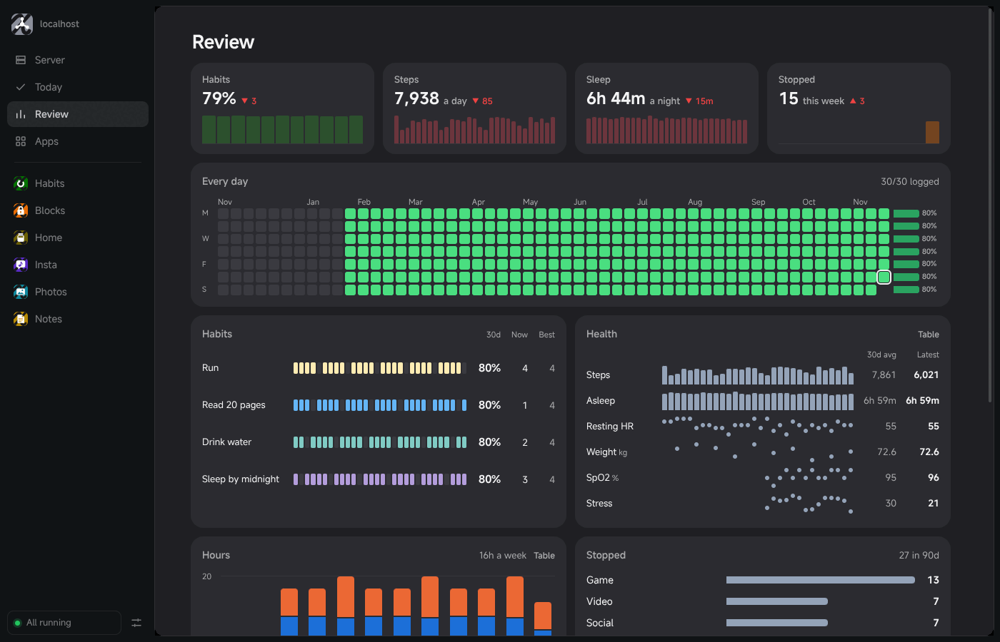

The laptop app on Review, in a made-up dark desktop theme.

`desktop/` (0.1.2) is a window that holds every page on the home server, so none of them needs a
browser tab: the hub's Server, Today, Review and Apps down a sidebar, then the habits web app,
xrnrule's Blocks page, xrnhome's laptop version, the song list, xrnimg's photo library and
xrnnote's notes. Each page is the server's own, drawn on a rounded sheet beside the sidebar and
kept loaded once opened, so going back to one is instant and it is where you left it. A link from
one page to another (the hub's Habits icon, the habits app's Blocks button) switches pages; a link
to anywhere else opens in the usual browser.

The first start asks for the server's address and the sync password, and signs every page in at
once. The password is kept in the system keyring, which answers the pages that ask for it with a
password box (xrnhome's laptop version). The sidebar marks a page whose server is down, and its
last line says whether all is well; the button beside it opens the settings, with the address, the
account and Sign out.

The frame takes the desktop's colours from the current Omarchy theme
(`~/.local/state/omarchy/current/theme/colors.toml`) and changes with it, and the pages follow the
theme's light or dark. Off Omarchy it follows the system's. Radicale's own page is left out: it only
makes and renames calendars, which xrncal does, and wants the calendar password every time.

`Ctrl+1`…`Ctrl+8` change page, `Ctrl+R` or `F5` reloads one (`Ctrl+Shift+R` without the cache),
`Alt+←` `Alt+→` go back and forward, `Ctrl+=` `Ctrl+-` `Ctrl+0` zoom and `Ctrl+Q` quits.
`xrnhub --page=today` opens a page, in the window already open if there is one; the launcher entry
has Today, Review and Server as actions.

```sh
cd desktop
npm test                 # unit tests
npm run test:window      # the app for real, headless, against tests/demo_server.py
npm start                # try it from the checkout
npm run app:install      # tests, then ~/Applications/xrnhub.AppImage and its launcher entry
```

`app:install` runs both test suites first and stops if either fails. A fix for a window test that
fails under load, and for a turned-off nudge card that could come back for a minute, is in review
(PR #31).

It keeps its settings and the pages' sign-in in `~/.config/xrnhub-desktop`. The launcher runs the
AppImage unpacked into `~/.cache/xrnhub`, so it doesn't depend on a FUSE mount staying up. It is
Electron with no build step: `main.js` holds the window and its rules, `pages.js` which address
belongs to which page, `theme.js` the frame's colours, `logins.js` the password boxes, and `shell/`
the sidebar.

## Running it

Python 3.11 or newer, plus `bcrypt`.

```sh
python3 server/xrnhub.py --port 5238 --web web \
  --data ./data --users <htpasswd file> --home <folder holding the services' data>
```

Open `http://127.0.0.1:5238/xrnhub/` and sign in with a user from the htpasswd file. To see every
page filled in without a home server, run `python3 tests/demo_server.py <empty folder>` instead: it
prints where it listens and where the password is.

To install it on a home server next to the other sync services (Termux, runit and Tailscale Funnel):

```sh
server/deploy.sh [ssh-host]
```

It runs the tests first and changes nothing if they fail, then copies `xrnhub.py`, `hublib/` and
`web/` across, sets up the runit service on first use and restarts it after that. The hub's own data
stays in `~/xrnhub/data` on the server.

### How it fits together

The hub runs on the same machine as the services it shows, so it reads their files: xrnloops'
SQLite, xrnrule's, xrnwal's and xrnhome's JSON, Radicale's calendars and xrninsta's song list.
That needs no stored password and adds no load to them, and `server/hublib/sources.py` is the only
file that knows those formats. A service that isn't set up, or a file that won't parse, reads as
empty: the page shows less and doesn't fall over. Apps can also report to the hub
(`POST /api/events`, such as xrnmail saying how many emails it's holding), and xrnfit posts health
to `POST /api/health`, which the hub keeps in `hub.sqlite`.

Sign-in is the shared `xrn_session` cookie, or Basic auth for devices, against the users file all
the sync services share. Ten wrong passwords from one address in 15 minutes get a 429, and signing
out ends the cookie on every server that takes it.

[docs/design.md](docs/design.md) explains each choice: why it reads files, days, nudges, the
monitor, the phone app's alerts, the API and security.

## Limits

- Android shuts most of `/proc` to apps, so there is no overall CPU figure for the phone.
- Versions show only where the server hands them out (xrnrule's app and extension, xrnhome, xrntube),
  plus, in the phone app, what that phone has installed. The laptop apps and Zen's extensions report
  none.
- Health counts one source a day for each measure, so a day that changed source shows one source's
  figures. Distance and active energy are kept and served by the API, but no page draws them.
- Health keeps calendar days, so between midnight and the habit day's start (3:00 by default) the
  pages show yesterday's health beside yesterday's habits.
- The hub stores no calendar password, so it can't add events or log time.

## Tests

```sh
cd tests && python3 -m unittest test_health test_ical test_daybook test_rules test_review test_monitor test_server test_api test_apps test_deploy
cd android && ./gradlew :app:testDebugUnitTest
cd desktop && npm test && npm run test:window
cd tests && python3 -m unittest test_public    # scripts/: the public copy's snapshot and scan
```

CI runs the server tests on every push and pull request, and the phone app's when `android/`
changes. They use made-up data. Never add real data to this repo.

## Licence

[MIT](LICENSE) © Xernnn.

The pages, the phone app and the laptop app are set in MiSans by Xiaomi, used under the MiSans
font licence (free for commercial use when the software notes that it uses MiSans). The font files,
in `web/fonts/` and `android/app/src/main/res/font/`, are not covered by this repository's licence.
https://hyperos.mi.com/font/en/
